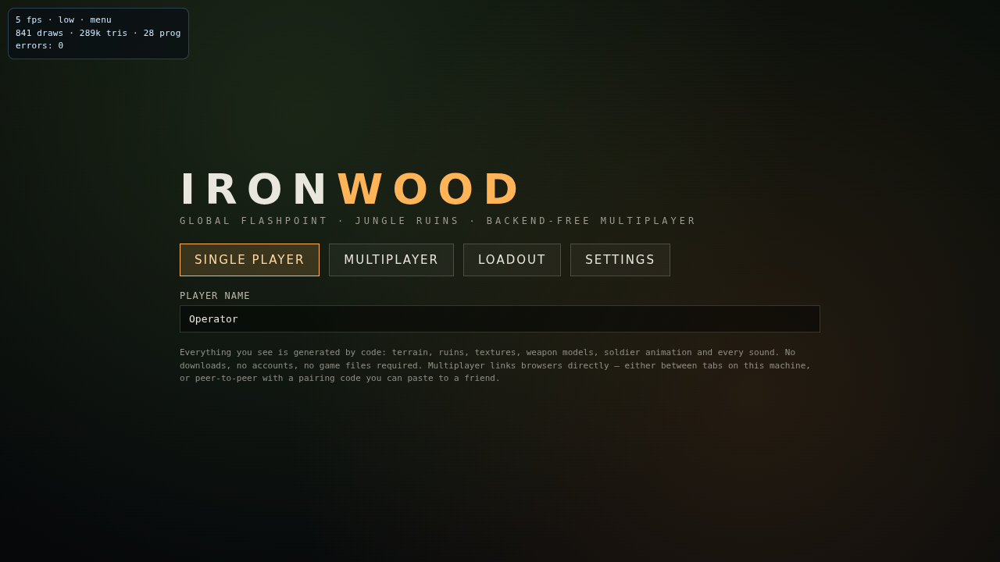
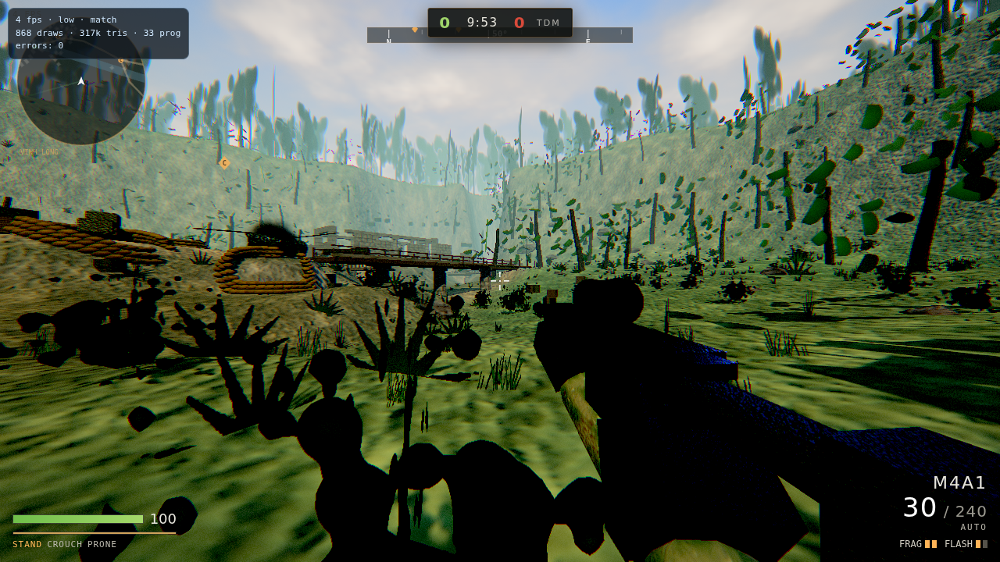
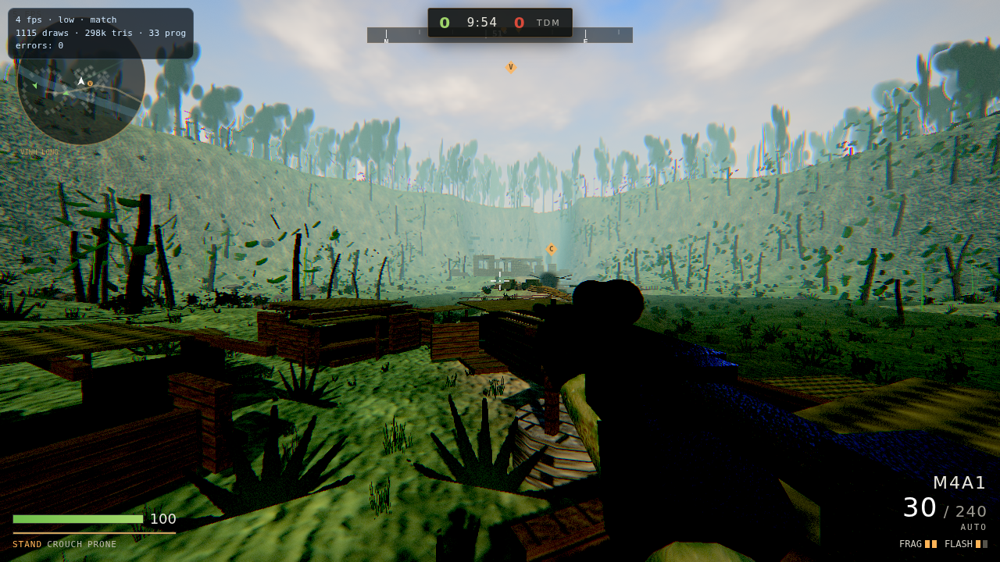
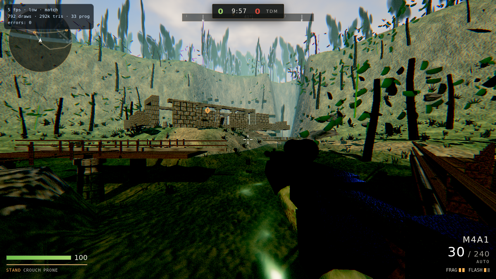
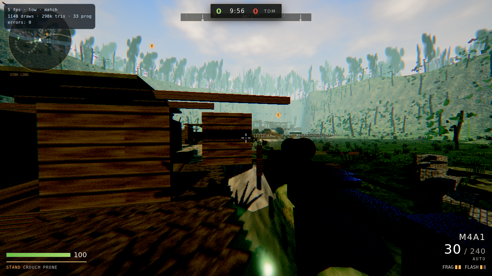
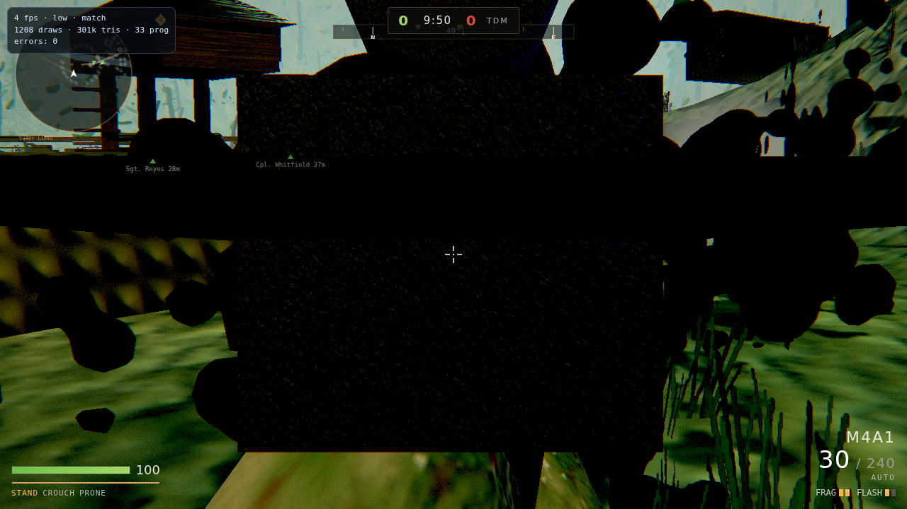

# IRONWOOD

A browser tactical shooter built from scratch: **three.js + WebGL2**, zero downloaded
assets, zero backend. Jungle ruins, scoped rifles, soldiers that move like soldiers —
all of it generated by code at load time.

Think *Modern Warfare 2 "Overgrown" vibes*, but everything here is original work:
procedural textures, procedural soldier rigs, procedural audio, procedural jungle.








These are frames from a real headless-Chromium run of the game (software rendering,
low quality) — `npm run shots` regenerates them.

```
cd ironwood
npm start          # serves on http://localhost:8080
```

Then open the printed URL and press **SINGLE PLAYER → DEPLOY**. (Screenshots above are
captured from the real game in a headless Chromium by `npm run test:browser` — no
mock-ups.)

---

## What's in the box

| System | Notes |
| --- | --- |
| **Renderer** | three.js (vendored, MIT) with a hand written post chain: MSAA HDR target → bright pass → 3-mip bloom → volumetric god rays → ACES tonemap → filmic grade, chromatic aberration, grain, vignette, scope mask |
| **Textures** | ~30 materials baked in the browser from analytic functions (albedo + derived normal + packed ORM) plus 14 alpha sprites (foliage, smoke, decals, muzzle flash, tree silhouettes) |
| **World** | Analytic heightfield valley, river with five crossings, paths, temple complex, ruined village, forward operating bases, ridgeline jungle wall, instanced jungle with wind |
| **Lighting** | Sun + hemisphere + bounce fill, player-following shadow frustum (2048), exponential fog, gradient sky with procedural clouds |
| **Audio** | 100% synthesised Web Audio: gunshots with jungle slapback, footsteps per surface, radio callouts, ambience (wind, cicadas, distant firefights) |
| **Soldiers** | Procedurally rigged humanoids, team camo, hitboxes, procedural walk/run/crouch/aim/death animation, nameplates |
| **Weapons** | Procedural models, recoil patterns, spread model, ADS, reloads, ballistics, frag + flash grenades |
| **Bots** | Nav-grid A* pathing with wading/cliff rules, vision cones with LOS, sound awareness, cover usage, squad callouts, four difficulty tiers |
| **Netcode** | Backend-free: WebRTC data channels (copy/paste pairing codes, host-authoritative) or BroadcastChannel for same-device tabs, 15 Hz snapshots + 30 Hz inputs, client-side prediction |
| **HUD** | COD-style: minimap radar, compass, ammo, killfeed, scoreboard, hitmarkers, damage arcs, match flow |

## Multiplayer without a backend

Two players (or more) link up directly — no server, no account, no third party:

1. **Same-device tabs** — one player hosts, others join with a 4-character room code.
   Instant, because the tabs share a `BroadcastChannel`.
2. **Peer-to-peer (WebRTC)** — the host generates a **pairing code**, sends it to a
   friend, they send back an **answer code**, done. Codes are deflate-compressed and
   base64url-encoded so they survive Discord/WhatsApp. Traffic flows directly between
   browsers; public STUN servers are only used to discover addresses.

The host simulates the match (bots included) and streams snapshots at 15 Hz; guests
send inputs at 30 Hz and run local prediction for their own soldier.

## Controls

| Action | Key |
| --- | --- |
| Move | `W A S D` |
| Sprint | `Shift` |
| Jump / Crouch / Prone | `Space` / `C` / `Z` |
| Fire / ADS / Melee | Mouse `LMB` / `RMB` / `MMB` (or `V`) |
| Reload | `R` |
| Frag / Flash | `G` / `Q` |
| Swap weapon | `E` or `1`/`2` |
| Hold breath (sniper) | `Shift` while scoped |
| Scoreboard | `Tab` |
| Pause | `Esc` |

Touch controls (dual sticks, fire, ADS, crouch, reload) appear automatically on
touch devices.

## URL parameters

Any link can configure the match — handy for sharing a specific setup:

```
index.html?quality=high&bots=8&difficulty=veteran&autostart=1
index.html?quality=low&diag=1        # on-screen fps / draws / error badge
index.html?photo=1&autostart=1       # photo mode: match frozen, HUD hidden
```

`window.ironwood` is exposed in the console: `diag()`, `teleport(x, z)`, `lookAt(x, z)`,
`setSimulate(false)`.

## Verification

The browser is the real target, so it is tested in a real (headless) Chromium with a
strict console watch, plus head-less logic tests in Node:

```
npm test              # 23 logic checks: world, nav graph, bridges, physics,
                      # weapons, bot firefights, match rules, netcode
npm run test:nav      # connectivity report: components, landmarks, routes
npm run test:browser  # boots the page, deploys, walks, shoots, screenshots;
                      # fails on any console error, page error or 404
npm run shots         # same, but only screenshots (docs/screenshots were made here)
```

The browser test needs a Chromium/Chrome binary. It uses `IW_CHROME=/path/to/chrome`
or falls back to `/tmp/chromium` (the sandbox's static Chromium), then to whatever
`puppeteer-core` can find; `IW_LIBS` adds a shared-library directory when the binary
ships its own runtime. Everything it prints, captures and measures lands in
`shots/report.json` (`--out=DIR` to change that).

Tooling beyond the tests:

```
node tools/nav-probe.mjs x,z    # why is this spot (not) walkable?
node tools/check-modules.mjs    # every import resolves
```

## Status / roadmap

- [x] Project scaffold, vendored three.js, dev server, module checker
- [x] Procedural texture library + post processing + sky/lighting
- [x] World generation (terrain, river crossings, ruins, jungle, minimap data)
- [x] Navigation: wading/steepness rules, island stitching, one connected graph
- [x] FX layer (tracers, impacts, decals, smoke, explosions)
- [x] Soldier rigs + animation
- [x] Weapon system + procedural viewmodels
- [x] Player controller, bot AI, match rules
- [x] HUD + menus + matchmaking flow
- [x] Multiplayer wiring (host authoritative + pairing UI)
- [x] Browser test harness with screenshots and console-error gate
- [x] Adaptive quality: software rasterisers and weak GPUs drop to low/MSAA-off
      automatically instead of dying (detected at boot, reported in `diag()`)
- [x] Graphics-context-loss handling: a driver reset now shows a clear message
      instead of a frozen black screen
- [ ] Stage 3 polish: draw-call batching, canopy shadows, sniper scope FX, audio mix,
      damage model tuning, more cover geometry

## Known limits

- The vegetation is billboard-card foliage: it reads as a dense jungle, but up close
  the cards are visible as cards. Replacing them with a proper LOD tree mesh is the
  next art step.
- Structure meshes are drawn individually (~1200 draw calls at medium/high). Fine on
  a GPU, slow on software rendering — merging static architecture is on the roadmap.
- Software rendering (SwiftShader, i.e. no GPU at all) runs at a few fps. Any real
  GPU handles the scene comfortably.

## Legal

Everything in this folder is original code written for this project. three.js is
vendored under its MIT licence (`vendor/three.LICENSE.txt`). No game assets,
textures, sounds or data from any commercial title are used or required.

Licence: MIT (see repository root).
